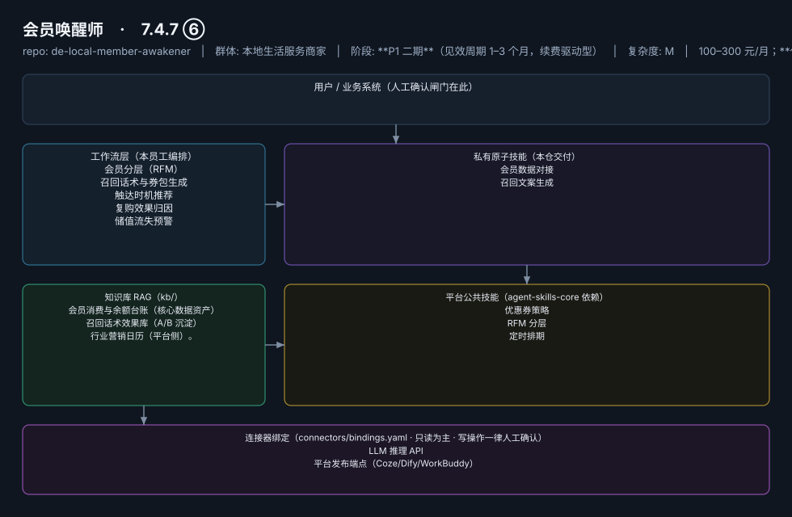

# 会员唤醒师

> 把储值卡里沉睡的现金流一笔笔唤醒
>
> **7.4.7 ⑥**　·　本地生活服务商家　·　阶段 **P1 二期**（见效周期 1–3 个月，续费驱动型）　·　
> 复杂度 M　·　100–300 元/月；**代配置服务加成：300–800 元/次**（历史会员台账整理导入+首批召回活动策划）　·　定义卡 7.4.7 ⑥



**一句话**：美业/健身/教培/餐饮储值型门店

---

## 这个数字员工解决什么问题

Mock 先行（Excel 台账导入即可跑 W1/W2/W5，冷启动关键设计）→ 云端定时。

| 项 | 内容 |
|---|---|
| 服务对象 | 美业/健身/教培/餐饮储值型门店 |
| 可量化目标 | 复购率 15%→25%（爱美云案例已验证，凤凰网，据 R4 调研）；90 天沉睡会员召回率 ≥8% |
| 投入产出 | 复购率 15%→25% 已被案例验证（据 R4 调研）；对储值型门店等于直接挽回现金流 |
| 需求依据 | D21 |
| 分发渠道 | GitHub（必备）、小红书、**千问办公**（Excel 台账场景契合办公入口）、豆包工作 |

## 30 秒上手

```bash
git clone <本仓库地址> && cd de-local-member-awakener
pip install pyyaml
python3 tests/run.py            # 先跑一遍自检，确认环境与契约都对得上
```

试用（把 `<输入>` 换成本人真实材料）：

```text
请以「会员唤醒师」的身份，帮我跑「会员分层（RFM）」。
材料如下：<输入>
要求：只使用材料里出现过的数字，缺的写 <待填>；对外文案停在待确认状态。
```

详细接入见 [`docs/01-安装与接入.md`](docs/01-安装与接入.md)。

## 仓库结构

```text
de-local-member-awakener/
├── employee.yaml          # 机器契约（能力清单 + 依赖锁）
├── dependencies.yaml      # 对 core 的外部依赖（含版本）
├── persona/               # 运行提示词 / 边界 / KPI
├── skills/                # 私有原子技能（2 个）
├── spec-bindings/         # 有意不公共化能力的本地绑定声明（0 个）
├── workflows/             # 本员工工作流（5 条）
├── kb/                    # 知识库 RAG 契约
├── connectors/            # 连接器绑定（只读为主，写操作人工确认）
├── docs/                  # 六类发布文档
└── tests/                 # 自动化多场景测试
```

## 私有原子技能（2）

| 技能 | slug | 复杂度 | 阶段 | 成熟度 |
|---|---|---|---|---|
| `会员数据对接` | `member-data-sync` | M | P1 | 契约完备 |
| `召回文案生成` | `winback-copy-generator` | S | P1 | 契约完备 |

## 平台公共技能依赖（3）

| 技能 | slug | 全平台复用员工数 |
|---|---|---|
| `优惠券策略` | `coupon-strategy` | 1 |
| `RFM 分层` | `rfm-segmentation` | 2 |
| `定时排期` | `scheduled-dispatch` | 6 |

> 这些技能来自 `agent-skills-core@1.0.0`，本仓库**只引用不复制**。

## Spec 绑定层（0）

（无）

> 这一族能力**有意不公共化**（与外部平台接口强绑定）。本仓不存正文，
> 只留本地绑定声明与连接器配置。

## 工作流（5）

| 工作流 | slug | 触发 | 阶段 | 调用技能数 |
|---|---|---|---|---|
| `会员分层（RFM）` | `wf-local-member-segment` | 定时（每周） | P1 | 2 |
| `召回话术与券包生成` | `wf-local-member-wakeup-copy` | 随 W1 联动 | P1 | 2 |
| `触达时机推荐` | `wf-local-member-touch-timing` | 定时（每日） | P1 | 1 |
| `复购效果归因` | `wf-local-member-repurchase-attribution` | 定时（每月） | P2 | 2 |
| `储值流失预警` | `wf-local-member-storedvalue-churn` | 定时（每周） | P1 | 1 |

## 知识库与连接器

- 知识库语料：['会员消费与余额台账（核心数据资产）', '召回话术效果库（A/B 沉淀）', '行业营销日历（平台侧）。']
- 连接器：LLM 推理 API、平台发布端点（Coze/Dify/WorkBuddy）

## 质量与验收

| 项 | 值 |
|---|---|
| 技能文件数 | 52 |
| 多场景用例数 | 206 |
| 用例通过 | 206 |
| 验收结论 | ✅ 通过 |

完整报告：[`docs/05-验收与测试.md`](docs/05-验收与测试.md)

## 许可

专有许可，详见 [`LICENSE`](LICENSE)。
